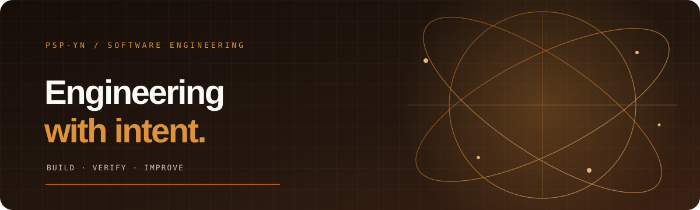

<!--
  PSP-YN GitHub profile README
  Portfolio order is based on repository evidence, implementation maturity,
  practical impact, launch potential and interview value.
-->

  
    
  
  
  

---

## Profile

I'm a Computer Science and Engineering undergraduate at **Vidyavardhaka College of Engineering (VVCE), Mysuru, India**. I build and experiment with software across **product engineering, applied AI, developer automation, Linux systems and application security**.

My approach is to understand the problem, design a practical system, implement a complete workflow and verify its behaviour. I use AI-assisted development tools, but architecture, testing, technical decisions and the final result remain my responsibility.

| | |
|---|---|
| **Education** | B.E. Computer Science & Engineering · VVCE, Mysuru |
| **Academic recognition** | CSE Best Achiever · 2025–26 |
| **Academic record** | 8.70 CGPA through Semester II |
| **Community** | ASPERA · VVCE entrepreneurship club |
| **Current focus** | Full-stack products · Applied AI · Automation · AppSec |

## Featured engineering work

The projects below lead my portfolio because they offer the strongest combination of implementation evidence, practical relevance and technical discussion. Status is stated conservatively.

### 1. CareerOS — Career development workspace

A career-planning product connecting target roles, skill-gap analysis, learning roadmaps, interview practice and application tracking.

- **State:** Deployed and evolving; recent main-branch CI passed.
- **Engineering:** Resume tooling, structured interview rounds, guest workspace, Supabase-backed sync and optional authenticated AI reviews.
- **Not claimed:** Paid subscriptions are not live until merchant configuration and end-to-end verification are complete.
- **Stack:** JavaScript · Supabase · Vercel · Gemini.
- **Live product:** [careeros-intelligence.vercel.app](https://careeros-intelligence.vercel.app)  
- **Repository:** [PSP-YN/CareerOS](https://github.com/PSP-YN/CareerOS)

### 2. DaemonX — Android automation and personal knowledge platform

A Linux-controlled Android automation system combining ADB, accessibility-tree inspection, OCR, computer vision, task persistence and an MCP interface.

- **State:** Active local platform; latest main-branch CI passed on 30 October 2026.
- **Engineering:** Observe–act–verify workflows, resumable tasks, SQLite FTS5 knowledge indexing and a local dashboard.
- **Validation still needed:** A repeatable physical-device demonstration and measured device-compatibility results.
- **Stack:** Python · MCP · ADB · Tesseract · OpenCV · SQLite.
- **Repository:** [PSP-YN/DaemonX](https://github.com/PSP-YN/DaemonX)

### 3. LangAssist — Offline Linux desktop writing assistant

A lightweight, non-LLM grammar and spelling assistant using Linux accessibility APIs to inspect text fields and apply corrections in place.

- **State:** Linux desktop implementation; main-branch CI passed.
- **Engineering:** Rust core, Harper rules, AT-SPI integration, sensitive-field exclusions and guarded in-place edits.
- **Validation still needed:** A published compatibility matrix across GTK, Chromium and Electron applications.
- **Stack:** Rust · Harper · AT-SPI · GTK4 · Libadwaita.
- **Repository:** [PSP-YN/LangAssist](https://github.com/PSP-YN/LangAssist)

### 4. NexHelp — Trust-first home-services marketplace

A customer/provider marketplace initially scoped to plumbing and electrical services in Bengaluru.

- **State:** Pilot candidate; latest main-branch CI passed.
- **Engineering:** Flutter mobile app, PostgreSQL migrations, Supabase RLS, provider verification and an internal operations dashboard.
- **Validation still needed:** Provisioned services, messaging setup, real provider onboarding and a controlled pilot.
- **Stack:** Flutter · Supabase · PostgreSQL · Next.js.
- **Repository:** [PSP-YN/NexHelp](https://github.com/PSP-YN/NexHelp)

### 5. SyncSphere — Campus event network

A campus platform for event discovery, student/faculty/admin roles, moderation, team formation, chat and reminders.

- **State:** App prototype; main-branch CI and release workflows passed.
- **Engineering:** Expo/React Native, TypeScript, Supabase Auth, PostgreSQL RLS and realtime workflows.
- **Validation still needed:** A controlled campus pilot, adversarial RLS testing and evidence of actual adoption.
- **Stack:** Expo · React Native · TypeScript · Supabase.
- **Repository:** [PSP-YN/SyncSphere](https://github.com/PSP-YN/SyncSphere)

### 6. NOVA — Linux desktop AI agent

A desktop-agent project exploring accessibility-based perception, local knowledge retrieval, task execution and a persistent command interface.

- **State:** Active build; README reports 168 tests, but no recent GitHub Actions run was found during this review.
- **Validation still needed:** Reproduce the test suite on a clean environment and demonstrate the advertised integrations end to end.
- **Stack:** Python · Linux · AT-SPI · Ollama · SQLite.
- **Repository:** [PSP-YN/NOVA](https://github.com/PSP-YN/NOVA)

### 7. Aegis Agent — Application security assessment platform

A security engineering project exploring browser/IDE discovery, application-state graphs, threat modelling, evidence and remediation.

- **State:** Advanced prototype; latest main-branch CI and deployment workflows failed in the repository audit.
- **Engineering:** FastAPI core, Chrome extension, IDE extension, SARIF reporting and remediation workflows.
- **Next milestone:** Restore CI/CD and publish a reproducible authorised security test target.
- **Stack:** Python · FastAPI · Chrome MV3 · VS Code · SARIF.
- **Repository:** [PSP-YN/Aegis-Agent](https://github.com/PSP-YN/Aegis-Agent)

## Additional selected repositories

These projects are included because they were explicitly selected for this portfolio. Their status is not equivalent to the featured projects above.

| Rank | Project | Current assessment | Repository |
|---:|---|---|---|
| 8 | UIPath_automate | Runnable local invoice-review and support-triage demos; human approval and audit trail. Not yet a deployed UiPath Maestro project. | [Open](https://github.com/PSP-YN/UIPath_automate) |
| 9 | smiriti | Offline Android document notebook with local RAG, OCR and embeddings; release build and device performance need verification. | [Open](https://github.com/PSP-YN/smiriti) |
| 10 | RoadSoS | Emergency-response hackathon prototype; some service integrations are simulated or pending validation. | [Open](https://github.com/PSP-YN/road-safety_iit-hackathon) |
| 11 | FRAS | GPU face-recognition attendance service concept; camera deployment, accuracy and privacy controls need validation. | [Open](https://github.com/PSP-YN/fras) |
| 12 | JunctionOptima | Railway junction simulation and dispatch concept; optimizer implementation and evaluation need verification. | [Open](https://github.com/PSP-YN/JunctionOptima) |
| 13 | Girakshar / Speech Platform | STT, translation, diarization and TTS concept; model accuracy and end-to-end workflows need reproducible tests. | [Open](https://github.com/PSP-YN/tts-stt-translation) |
| 14 | AirLLM GUI | Large-model inference tooling; hardware and 4 GB GPU claims require reproducible benchmarks. | [Open](https://github.com/PSP-YN/airllm-gui) |
| 15 | Particle Motion | Gesture-controlled Three.js particle visualisation; useful interactive graphics demonstration. | [Open](https://github.com/PSP-YN/particle-motion) |
| 16 | GeoAlarm | Geofenced alarm prototype; README's production claims conflict with database/cache components marked planned. | [Open](https://github.com/PSP-YN/alarm-with-map) |
| 17 | DFRG | Digital-footprint privacy scaffold; core scan, insight and action screens are placeholders. | [Open](https://github.com/PSP-YN/dfrg) |
| 18 | Sampark | Flutter app shell and local registry; device pairing, messaging and automation execution are not operational. | [Open](https://github.com/PSP-YN/Sampark) |
| 19 | ARTEMIS | Fork of google/artemis. Only independently authored contributions should be attributed as my work. | [Open](https://github.com/PSP-YN/artemis) |
| 20 | Intelligence Traffic Management | Repository currently contains only .gitignore; no implementation found. | [Open](https://github.com/PSP-YN/intelligence-traffic-management-system) |
| 21 | Mysuru Tourism Enhancement | Repository currently contains only .gitignore; no implementation found. | [Open](https://github.com/PSP-YN/mysuru-tourism-enhancement) |
| 22 | Scientific Calculator Game | Empty repository; no implementation available for review. | [Open](https://github.com/PSP-YN/Scientific-calculator-game) |
| 23 | NEXA | Empty repository; no implementation available for review. | [Open](https://github.com/PSP-YN/NEXA) |

**Portfolio methodology:** This order is a qualitative prioritisation based on repository contents, recent CI evidence, implementation maturity, practical relevance, launch dependencies and interview value. It is not proof of customer adoption, production reliability or commercial traction. A passing CI run verifies only the checks configured in that workflow.

## Technical landscape

Tools and technologies I have used or explored through projects and coursework. This is a working toolkit, not a claim of equal proficiency in every item.

**LANGUAGES**

**WEB, MOBILE & BACKEND**

**DATA, PLATFORM & TOOLING**

## Learning and participation

- **VVCE CSE Best Achiever** — 2025–26; 8.70 CGPA through Semester II.
- **ASPERA, VVCE** — entrepreneurship and innovation community participation.
- **PES Mandya Pioneer / Pioneer 3.0**, **Infothon 7.0**, **CODE RED 3.0 (Round 1)** and **SolveCon 2026**.
- **Smart India Hackathon 2026** — team problem-statement work around SIH26264 and SIH26265. Participation only; no win or finalist claim.

### Selected learning credentials

C Programming Fundamentals (University of California, Santa Cruz) · Artificial Intelligence: An Overview (Politecnico di Milano) · Information & Digital Literacy for University Success (University of Sydney) · Electrical Power Generation — An Industrial Outlook (L&T EduTech).

## GitHub activity

  
  

  

## Connect

[Portfolio](https://pspyn-portfolio.vercel.app/) · [GitHub](https://github.com/PSP-YN) · [LinkedIn](https://linkedin.com/in/pspyn)

**Personal:** [psppspyn13@gmail.com](mailto:psppspyn13@gmail.com)  
**VVCE:** [vvce25cse0402@vvce.ac.in](mailto:vvce25cse0402@vvce.ac.in)

---

  Build with curiosity. Verify with evidence. Ship with intent.

