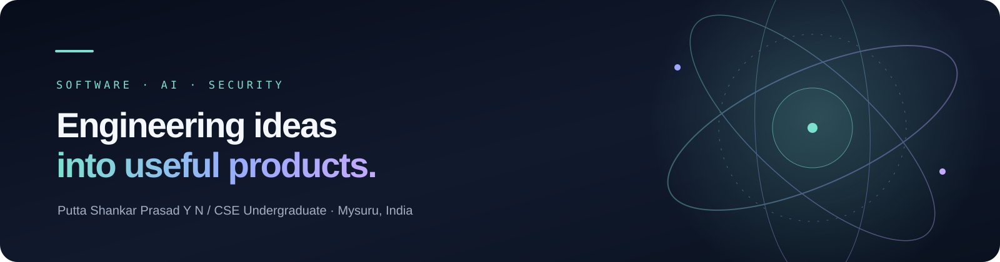

<!-- Profile README for PSP-YN -->

  

<h1 align="center">Putta Shankar Prasad Y N</h1>

  <strong>CSE Undergraduate · Software Builder · Aspiring Product Engineer</strong> 
  Mysuru, India

  <a href="https://pspyn-portfolio.vercel.app/">Portfolio</a> ·
  <a href="https://linkedin.com/in/pspyn">LinkedIn</a> ·
  <a href="mailto:puttashankarprasadyn11@gmail.com">Email</a>

---

### About

I’m pursuing a **B.E. in Computer Science and Engineering at Vidyavardhaka College of Engineering (VVCE), Mysuru**. I’m interested in building useful software products, especially where full-stack engineering, applied AI, security and automation meet.

My approach is practical: understand the problem, build a focused version, test it, and improve it from evidence. I’m still learning, and I distinguish deployed work from active development and early prototypes.

- **Academic recognition:** VVCE CSE Best Achiever — 2025–26
- **Academic record:** 8.70 CGPA through Semester II
- **Community:** ASPERA, VVCE entrepreneurship club
- **Current direction:** Full-stack development, applied AI and application security

### Featured work

| Project | Focus | Status |
|---|---|---|
| **[CareerOS](https://github.com/PSP-YN/CareerOS)** · [Live](https://careeros-intelligence.vercel.app) | Career planning, skill-gap analysis, learning roadmaps and structured interview preparation. | **Deployed · evolving** |
| **[Meeting Vault](https://github.com/PSP-YN/Meeting_Vault)** | Audiovisual meeting capture, local runner workflows and searchable meeting archives. | In development |
| **[Aegis Agent](https://github.com/PSP-YN/Aegis-Agent)** | Application-security tooling exploring browser/IDE signals, application-state mapping and evidence-led remediation. | In development |
| **[LangAssist](https://github.com/PSP-YN/LangAssist)** | Lightweight, local-first grammar assistance for Linux desktop workflows. | In development |

I keep the public showcase intentionally selective. Other experiments and coursework are available in the [repositories tab](https://github.com/PSP-YN?tab=repositories).

### Technical toolkit

**Languages** · C · C++ · Python · JavaScript · TypeScript  
**Frontend & mobile** · HTML · CSS · React · Next.js · Flutter  
**Backend & data** · Node.js · REST APIs · PostgreSQL · Supabase  
**Platform & tools** · Linux · Git · GitHub Actions · Docker · Vercel · Cloudflare

These represent technologies I have used or explored in coursework and projects, not a claim of professional mastery across every item.

### Beyond coursework

I take part in student-led building, innovation and competition activities through VVCE and ASPERA. Selected experiences include **PES Mandya Pioneer / Pioneer 3.0**, **Infothon 7.0**, **CODE RED 3.0 (Round 1)** and **Smart India Hackathon 2026** team problem-statement work around SIH26264 and SIH26265. These are participation records; I do not present them as wins or finalist placements.

Selected learning includes C programming (UC Santa Cruz), Python, AI fundamentals (Politecnico di Milano), engineering mathematics (BITS Pilani) and electrical power systems (L&T EduTech). The broader credential record is on [LinkedIn](https://linkedin.com/in/pspyn).

### Connect

- **Portfolio:** https://pspyn-portfolio.vercel.app/
- **LinkedIn:** https://linkedin.com/in/pspyn
- **GitHub:** https://github.com/PSP-YN
- **Email:** puttashankarprasadyn11@gmail.com

Learning by building · Engineering with intent · Improving through feedback

